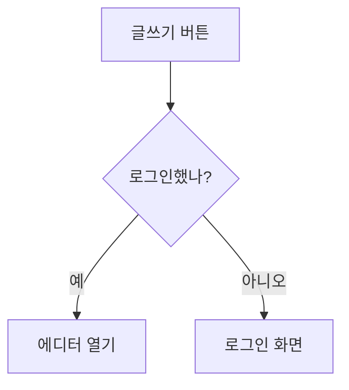
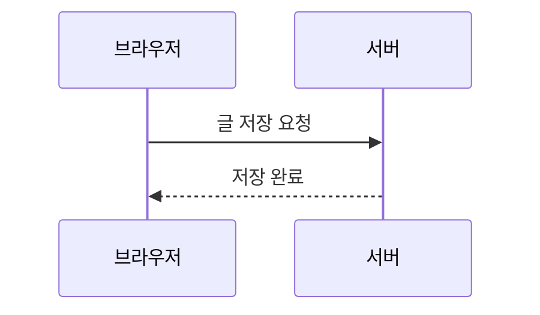

## 시작하기 전에

Unblind의 글은 **마크다운**으로 씁니다. 마크다운은 `#`, `*` 같은 기호 몇 개로 제목이나 굵은 글씨를 표시하는 글쓰기 방식입니다. 버튼을 누르는 대신 기호를 직접 쓰고, 기호는 저장된 글에서 보이지 않습니다.

글쓰기 화면은 넓은 화면에서는 왼쪽이 입력란, 오른쪽이 미리보기입니다. 좁은 화면에서는 위쪽 탭으로 둘을 오갑니다. 아래 예시를 따라 쓰면서 미리보기가 어떻게 바뀌는지 보면 금방 익숙해집니다.

이 문서의 예시는 모두 같은 형식입니다. 회색 상자 안이 **입력하는 내용**이고, 그 아래가 **실제로 보이는 모습**입니다.

> [!TIP]
> 처음이라면 "글 정보 입력란", "문단과 줄바꿈", "제목", "강조", "링크", "이미지"만 읽어도 대부분의 글을 쓸 수 있습니다. 나머지는 필요할 때 찾아보세요.

## 글 정보 입력란

로그인하면 화면 오른쪽 위의 펜 아이콘이 글쓰기 버튼입니다. 글쓰기 화면의 본문 위에는 글의 정보를 적는 칸이 있습니다.

- **제목:** 꼭 써야 합니다. 서버에는 제목을 50자까지 담을 수 있는 칸이 있습니다.
- **부제목:** 선택입니다. 100자까지 담을 수 있는 칸입니다.
- **태그:** 쉼표로 나눠 씁니다(예: `GPU, Kubernetes`). 앞에 붙인 `#`는 지워지고, 같은 태그는 한 번만 남습니다. 10개까지, 태그 하나는 30자까지입니다.
- **썸네일 이미지 URL:** `http://` 또는 `https://`로 시작하는 이미지 주소입니다. 바로 아래의 **썸네일 테두리**를 켜면 글 화면의 큰 이미지와 목록 카드의 썸네일에 연한 테두리가 그려집니다. 흰 배경 이미지가 페이지에 묻혀 보일 때 켜 보세요.
- **본문:** 꼭 써야 합니다. 아래부터 설명하는 마크다운으로 씁니다.

저장 방법은 두 가지입니다. **발행**을 누르면 모두에게 보이고, **숨김으로 저장**을 누르면 글 목록과 검색에 나오지 않고 작성자만 열어 볼 수 있습니다. 쓰는 동안의 내용은 이 브라우저에 임시 저장되고, 다시 열면 불러오거나 버릴 수 있습니다.

글 위쪽에 보이는 작성자 사진, 이름, 직무, 작성일은 글에서 고치는 것이 아니라 작성자의 프로필에서 자동으로 가져옵니다. 직무는 프로필의 경력 중 종료일이 없는 항목의 직무입니다.

## 문단과 줄바꿈

Enter를 **한 번** 누르면 줄만 바뀌고, **두 번** 눌러 빈 줄을 만들면 새 문단이 시작됩니다. 문단 사이에는 줄바꿈보다 넓은 간격이 생깁니다.

```markdown
첫 번째 줄입니다.
Enter 한 번이라 바로 아랫줄에 이어집니다.

빈 줄 다음이라 새 문단입니다.
```

첫 번째 줄입니다.
Enter 한 번이라 바로 아랫줄에 이어집니다.

빈 줄 다음이라 새 문단입니다.

### 간격 더 벌리기

두 블록(문단, 이미지, 코드 상자, 인용, 목록, 제목 등) 사이에 빈 줄을 **더 넣으면** 넣은 만큼 간격이 벌어집니다. 빈 줄 하나(Enter 두 번)가 기본 간격이고, 그보다 많은 빈 줄 하나마다 20px씩 더해집니다.

```markdown
위 문단입니다.


이 문단은 빈 줄이 3개라 기본보다 40px 더 떨어져 있습니다.
```

- 더해지는 양은 빈 줄 3개 더(60px)까지입니다. 그 이상은 같은 간격으로 보입니다.
- 코드 상자 안의 빈 줄은 코드 그대로이고 간격에 영향을 주지 않습니다.

## 제목

줄 맨 앞에 `##`를 쓰고 한 칸 띄우면 큰 제목, `###`이면 작은 제목이 됩니다. 제목은 글 오른쪽 **목차**에 자동으로 들어갑니다(넓은 화면에서만 보입니다).

```markdown
## 큰 제목
### 작은 제목
```

> [!NOTE]
> 글 제목은 입력란 위의 "제목" 칸에 따로 씁니다. 본문에서는 `#` 하나짜리 제목을 쓰지 말고 `##`부터 쓰세요. `####`처럼 더 작은 제목은 목차에 나오지 않습니다.

제목에 마우스를 올리면 오른쪽에 `#` 버튼이 나타납니다. 누르면 그 제목으로 바로 가는 링크가 복사됩니다. 링크 끝에는 제목 글자가 들어가므로, 글을 공유한 뒤 제목을 바꾸면 예전 링크는 그 위치로 가지 않습니다.

## 강조

```markdown
**굵게**, *기울임*, ~~취소선~~, ==형광펜==, `짧은 코드`
```

**굵게**, *기울임*, ~~취소선~~, ==형광펜==, `짧은 코드`

형광펜은 `==`로 감싸고, 앞뒤 `==`가 글자에 붙어 있어야 합니다. `a == b`처럼 띄어 쓴 `==`는 그대로 글자로 남습니다. 형광펜 안에 굵은 글씨를 넣을 수도 있습니다.

```markdown
==이 문장은 **핵심**이 들어간 형광펜입니다==
```

==이 문장은 **핵심**이 들어간 형광펜입니다==

## 링크

`[보여 줄 글자](주소)` 형식으로 씁니다. 주소만 써도 링크가 됩니다.

```markdown
[Unblind 소개](https://unblind.kr)를 읽어 보세요.
https://unblind.kr 처럼 주소만 써도 됩니다.
```

[Unblind 소개](https://unblind.kr)를 읽어 보세요.
https://unblind.kr 처럼 주소만 써도 됩니다.

링크는 본문과 같은 색에 옅은 밑줄로 보이고, 마우스를 올리면 밑줄이 진해집니다.

### GitHub 링크

GitHub의 사용자나 저장소 주소는 프로필 사진이 붙은 작은 칩으로 바뀝니다. 대괄호 안에 쓴 글자는 칩 옆에 회색 설명으로 붙습니다.

```markdown
https://github.com/facebook/react

[자주 참고하는 라이브러리](https://github.com/facebook/react)
```

https://github.com/facebook/react

[자주 참고하는 라이브러리](https://github.com/facebook/react)

### 글 카드

Unblind의 다른 글을 카드로 소개하려면 백틱 세 개 뒤에 `post`를 쓰고, 다음 줄에 글 주소 하나를 적습니다. 마지막 줄은 백틱 세 개로 닫습니다. 카드 앞뒤에는 빈 줄을 두세요.

````markdown
```post
/posts/123
```
````

`123`은 연결할 글의 번호로 바꿉니다. 글 주소가 `https://unblind.kr/posts/123`이라면 번호는 `123`입니다. 전체 URL을 넣어도 같은 카드가 됩니다.

````markdown
```post
https://unblind.kr/posts/123
```
````

카드 왼쪽에는 글의 제목, 부제목, 작성자와 작성일이 표시되고, 오른쪽에는 썸네일이 카드 가장자리에 붙어 표시됩니다. 썸네일이 없거나 불러오지 못하면 텍스트만 표시됩니다. 카드 전체를 누르면 연결된 글로 이동합니다. 제목이나 썸네일을 문법 안에 따로 적을 필요는 없습니다.

직접 문법을 쓰는 대신 편집기 위쪽의 **글 카드** 버튼을 눌러도 됩니다.

1. 본문에서 카드를 넣을 위치에 커서를 둡니다.
2. **글 카드**를 누르고 글 제목·부제목·작성자로 검색하거나 글 URL을 입력합니다.
3. 검색 결과에서 글을 선택하고 미리보기를 확인한 뒤 **삽입**을 누릅니다. URL을 직접 입력한 경우에는 바로 미리보기가 표시됩니다.

삽입한 카드는 본문의 미리보기에서도 확인할 수 있습니다. 다른 글로 바꾸려면 `post` 블록 안의 주소를 바꾸고, 카드를 없애려면 여는 백틱부터 닫는 백틱까지 블록 전체를 지웁니다.

- Unblind의 공개된 글만 카드로 연결할 수 있습니다. 외부 사이트 주소는 지원하지 않습니다.
- 글이 삭제되거나 비공개로 바뀌면 **볼 수 없는 글입니다.**로 표시됩니다. 일시적으로 불러오지 못한 경우에는 **다시 시도**를 누를 수 있습니다.
- 문장 속 일반 링크는 카드로 바뀌지 않습니다. 문장에 자연스럽게 넣으려면 `[참고 글](/posts/123)`처럼 쓰세요.

## 목록

줄 앞에 `-`를 쓰면 점 목록, `1.`을 쓰면 번호 목록입니다. 앞에 공백 두 칸을 넣으면 한 단계 들여 쓴 목록이 됩니다.

```markdown
- 사과
- 배
  - 신고배
  - 원황배

1. 재료를 준비합니다
2. 섞습니다
3. 굽습니다
```

- 사과
- 배
  - 신고배
  - 원황배

1. 재료를 준비합니다
2. 섞습니다
3. 굽습니다

`- [ ]`와 `- [x]`로 체크리스트를 만들 수 있습니다. 읽는 사람이 체크할 수는 없고, 쓴 대로 표시만 됩니다.

```markdown
- [x] 초안 쓰기
- [ ] 검토 받기
```

- [x] 초안 쓰기
- [ ] 검토 받기

## 인용과 안내 상자

줄 앞에 `>`를 쓰면 인용문이 됩니다.

```markdown
> 단순함은 궁극의 정교함이다.
```

> 단순함은 궁극의 정교함이다.

인용문 첫 줄에 `[!NOTE]` 같은 표시를 쓰면 색이 있는 안내 상자가 됩니다. 다섯 종류가 있습니다.

```markdown
> [!NOTE]
> 알아 두면 좋은 내용입니다.

> [!TIP]
> 더 잘하는 방법을 알려 줍니다.

> [!IMPORTANT]
> 꼭 알아야 하는 내용입니다.

> [!WARNING]
> 문제가 생길 수 있어 조심해야 합니다.

> [!CAUTION]
> 하면 위험한 일을 알립니다.
```

> [!NOTE]
> 알아 두면 좋은 내용입니다.

> [!TIP]
> 더 잘하는 방법을 알려 줍니다.

> [!IMPORTANT]
> 꼭 알아야 하는 내용입니다.

> [!WARNING]
> 문제가 생길 수 있어 조심해야 합니다.

> [!CAUTION]
> 하면 위험한 일을 알립니다.

## 이미지

가장 쉬운 방법은 이미지를 본문 입력란에 **붙여넣거나 끌어다 놓는** 것입니다. 업로드가 끝나면 아래 형식의 글자가 자동으로 들어갑니다. 인터넷에 있는 이미지라면 직접 써도 됩니다.

```markdown

```

대괄호 안의 설명은 이미지가 안 보일 때나 화면 낭독기가 읽어 줄 때 쓰입니다. 무엇이 찍힌 사진인지 짧게 적어 주세요.

설명 뒤에 `|`로 옵션을 붙일 수 있습니다.

- `| border`: 흰 바탕 이미지가 배경에 묻히지 않게 얇은 테두리를 그립니다.
- `| center`: 작은 이미지를 가운데에 놓습니다.
- `| 50%`, `| 300px`: 이미지 폭을 정합니다. `%`는 글 폭에 대한 비율(1~100%)이고, `px`는 화면 점 수입니다. 글 폭보다 큰 값은 글 폭에 맞춰집니다. 원래 크기보다 크게 지정하면 이미지가 늘어나 흐려질 수 있습니다.
- 여러 개를 쓰려면 `| center | border | 50%`처럼 이어 씁니다. 순서는 상관없습니다.

주소 뒤에 큰따옴표로 글을 쓰면 이미지 아래 **캡션**이 됩니다.

```markdown

```

## 코드

여러 줄의 코드는 백틱(`` ` ``) 세 개로 감쌉니다. 첫 줄의 백틱 뒤에 언어 이름을 쓰면 문법에 맞게 색이 칠해집니다.

````markdown
```java
public int add(int a, int b) {
    return a + b;
}
```
````

```java
public int add(int a, int b) {
    return a + b;
}
```

### 줄바꿈, 복사, 줄 표시

코드 상자에 마우스를 올리면 오른쪽 위에 버튼이 두 개 나타납니다. 오른쪽 버튼은 코드 전체를 복사합니다. 왼쪽 **줄바꿈** 버튼은 상자보다 긴 줄을 상자 폭에서 꺾어 보여 줍니다. 처음에는 꺼져 있어서 긴 줄은 가로 스크롤로 봅니다. 줄바꿈을 켜면 가로 스크롤이 없어지고, 꺾인 줄의 번호도 그 높이에 맞춰 늘어납니다. 코드 글자는 바뀌지 않으므로 복사되는 내용도 같습니다.

줄 번호를 누르면 그 줄이 노랗게 표시되고 주소 끝에 그 줄을 가리키는 표시가 붙습니다. Shift를 누른 채 다른 줄 번호를 누르면 범위가 선택됩니다. 그 주소를 공유하면 열어 보는 사람에게도 같은 줄이 표시됩니다. 좁은 화면(600px 이하)에서는 줄 번호가 숨겨집니다.

### 색이 칠해지는 언어

아래 이름이나 괄호 안의 별칭을 첫 줄 백틱 뒤에 쓰면 색이 칠해집니다.

- **웹과 문서:** `javascript`(`js`, `jsx`), `typescript`(`ts`, `tsx`), `json`(`jsonc`, `json5`), `xml`(`html`, `svg`), `css`, `scss`, `less`, `markdown`(`md`), `yaml`(`yml`), `ini`(`toml`), `graphql`(`gql`)
- **서버와 시스템:** `java`, `kotlin`(`kt`), `python`(`py`), `go`(`golang`), `rust`(`rs`), `c`, `cpp`(`c++`), `csharp`(`cs`), `php`, `ruby`(`rb`), `swift`, `objectivec`(`objc`), `vbnet`, `perl`, `lua`, `r`
- **도구와 기타:** `bash`(`sh`, `zsh`), `shell`(`console`), `sql`, `diff`(`patch`), `makefile`, `wasm`, `arduino`, `plaintext`(`text`, `txt`), `python-repl`, `php-template`

`jsx`와 `tsx`는 자바스크립트와 타입스크립트 규칙으로, `toml`은 `ini` 규칙으로 칠해지므로 그 언어에 꼭 맞는 색은 아닙니다.

아래 언어는 지원하지 않습니다: `dockerfile`, `nginx`, `powershell`, `vue`, `svelte`, `scala`, `dart`, `groovy`, `hcl`(`terraform`), `proto`, `http`, `regex`. 이 이름을 써도 오류는 나지 않고 색 없는 코드로 보입니다. 언어 이름을 쓰지 않은 코드 상자도 색이 칠해지지 않습니다. `chart`, `tree`, `mermaid`, `math`는 코드가 아니라 각각 그래프, 트리, 다이어그램, 수식으로 바뀌는 이름입니다(아래 각 절 참고).

## 표

`|`로 칸을 나누고, 둘째 줄에 `---`를 써서 머리줄과 내용을 구분합니다. 칸 너비는 맞추지 않아도 됩니다.

```markdown
| 이름 | 역할 | 경력 |
| --- | --- | --- |
| 김철수 | 백엔드 | 5년 |
| 이영희 | 프론트엔드 | 3년 |
```

| 이름 | 역할 | 경력 |
| --- | --- | --- |
| 김철수 | 백엔드 | 5년 |
| 이영희 | 프론트엔드 | 3년 |

## 수식

수식은 `$$`로 감쌉니다. 문장 안에 넣을 때는 한 줄에, 크게 따로 보여 줄 때는 `$$`를 위아래 줄에 따로 씁니다. 수식 문법은 LaTeX를 따릅니다.

```markdown
피타고라스 정리는 $$a^2 + b^2 = c^2$$ 입니다.

$$
\frac{1}{n}\sum_{i=1}^{n} x_i
$$
```

피타고라스 정리는 $$a^2 + b^2 = c^2$$ 입니다.

$$
\frac{1}{n}\sum_{i=1}^{n} x_i
$$

> [!NOTE]
> `$` 하나는 수식이 아닙니다. "5$와 10$"처럼 가격을 써도 수식으로 바뀌지 않습니다.

## 각주

문장 뒤에 `[^1]`을 쓰면 작은 번호가 붙고, 글 어디든 `[^1]: 내용`을 쓰면 그 내용이 글 맨 아래에 모입니다. 번호를 누르면 각주로, 각주를 누르면 다시 본문으로 이동합니다.

```markdown
이 수치는 2025년 조사 결과입니다.[^1]

[^1]: 통계청, 2025년 사업체 조사.
```

이 수치는 2025년 조사 결과입니다.[^1]

[^1]: 통계청, 2025년 사업체 조사.

대괄호 안은 숫자가 아니어도 됩니다(`[^출처]`). 화면에는 쓴 순서대로 1, 2, 3이 붙습니다.

## 그래프

` ```chart `로 시작하는 코드 상자에 표를 쓰면 그래프가 그려집니다. 마우스를 올리면 각 지점의 값을 볼 수 있습니다.

표는 쉼표로 칸을 나눕니다. 첫 줄은 머리줄로, 첫 칸은 가로축 이름이고 나머지 칸은 선(계열) 이름입니다. 그 아래 줄마다 가로축 값과 숫자를 씁니다.

````markdown
```chart
월, 방문자, 가입자
1월, 120, 10
2월, 180, 24
3월, 260, 41
```
````

```chart
월, 방문자, 가입자
1월, 120, 10
2월, 180, 24
3월, 260, 41
```

표 위에 설정을 쓰고 `---`로 구분하면 제목, 단위, 축 범위, 종류를 정할 수 있습니다. 설정은 모두 선택입니다.

- `title`: 그래프 제목
- `unit`: 값 뒤에 붙일 단위
- `min`, `max`: 세로축의 시작과 끝 값
- `type`: `line`(선, 기본값), `bar`(막대), `dot`(점)
- `limit`: 기준선. 숫자 뒤에 이름을 붙입니다(`limit: 256 한도`). 이름을 생략하면 "한도"로 표시됩니다.
- `band`: 기준 구간. 시작값과 끝값을 `~`로 잇고 이름을 붙입니다(`band: 200~256 권장 구간`). 이름을 생략하면 "기준 구간"으로 표시됩니다.

````markdown
```chart
title: 분기별 매출
unit: 억
type: bar
---
분기, 2024, 2025
1분기, 12, 15
2분기, 14, 19
3분기, 13, 22
```
````

```chart
title: 분기별 매출
unit: 억
type: bar
---
분기, 2024, 2025
1분기, 12, 15
2분기, 14, 19
3분기, 13, 22
```

### 한도나 목표와 비교할 때

한도를 막대 하나로 끼워 넣으면 측정값처럼 보입니다. 이럴 때는 `limit`으로 가로선을 긋고, 적정 범위가 있다면 `band`로 띠를 칠합니다. 두 설정은 선, 막대, 점 그래프 모두에 쓸 수 있습니다.

````markdown
```chart
title: 서비스별 메모리 사용량
unit: MB
type: bar
limit: 256 메모리 한도
band: 128~200 권장 구간
---
서비스, 사용량
api, 180
worker, 232
batch, 96
```
````

```chart
title: 서비스별 메모리 사용량
unit: MB
type: bar
limit: 256 메모리 한도
band: 128~200 권장 구간
---
서비스, 사용량
api, 180
worker, 232
batch, 96
```

### 큰 값 사이의 작은 차이를 보일 때

막대 그래프는 막대 길이로 값을 비교하므로 항상 0에서 시작합니다. 950과 1000처럼 큰 값 사이의 작은 차이를 보이고 싶다면 `type: dot`(점 그래프)을 씁니다. 점 그래프는 값을 점의 위치로 표시하므로 세로축이 데이터 근처에서 시작해도 왜곡이 없습니다.

````markdown
```chart
title: 응답 시간 p99
unit: ms
type: dot
---
버전, 응답 시간
v1, 1000
v2, 972
v3, 951
```
````

```chart
title: 응답 시간 p99
unit: ms
type: dot
---
버전, 응답 시간
v1, 1000
v2, 972
v3, 951
```

알아 둘 규칙은 다음과 같습니다.

- 선(계열)은 최대 6개까지 그릴 수 있습니다.
- 데이터 줄은 선 그래프가 2개 이상 2000개 이하, 막대와 점 그래프가 1개 이상 40개 이하여야 합니다.
- 선 그래프는 데이터가 많을수록 선이 가늘어지고(40개 넘으면 2px, 80개 넘으면 1.5px, 150개 넘으면 1px), 그래프 폭에 비해 점이 너무 많으면 그릴 때 줄여서 그립니다. 이때 각 구간의 가장 높은 값과 가장 낮은 값은 그대로 남기 때문에 갑자기 튀는 값도 보입니다. 마우스를 올렸을 때 보이는 값과 표에 쓴 값은 줄이지 않은 원래 값입니다.
- 막대 그래프는 0에서 시작해야 하므로 `min`은 0 이하, `max`는 0 이상이어야 합니다.
- `limit`과 `band`는 그래프마다 하나씩 쓸 수 있고, 이름은 20자까지입니다. `min`이나 `max`를 함께 정했다면 그 범위 안에 있어야 합니다.
- 표 안에는 빈 줄을 넣을 수 없습니다.
- 이름에 쉼표가 들어가면 큰따옴표로 감쌉니다(`"서울, 경기"`).

규칙에 맞지 않으면 그래프 대신 몇 번째 줄이 왜 틀렸는지 알려 주는 안내가 나옵니다.

## 트리

` ```tree `로 시작하는 코드 상자에 들여쓰기로 계층을 쓰면 트리 그림이 그려집니다. 폴더 구조나 조직도를 보여 줄 때 좋습니다.

````markdown
```tree
프로젝트
  src
    main
    test
  docs
  README.md
```
````

```tree
프로젝트
  src
    main
    test
  docs
  README.md
```

- 첫 줄은 들여 쓰지 않은 하나의 뿌리 항목이어야 합니다.
- 들여쓰기는 탭 대신 **공백**으로 하고, 같은 단계의 항목은 들여쓰기 칸 수를 똑같이 맞춥니다.
- 항목은 200개, 단계는 8개까지 쓸 수 있습니다.

## 다이어그램

` ```mermaid `로 시작하는 코드 상자에 [Mermaid](https://mermaid.js.org) 문법을 쓰면 다이어그램이 그려집니다. GitHub에서도 쓰는 문법이라, 거기서 쓰던 다이어그램을 그대로 붙여 넣을 수 있습니다.

### 흐름도

첫 줄에 `flowchart TD`(위에서 아래로) 또는 `flowchart LR`(왼쪽에서 오른쪽으로)을 씁니다. `[ ]`는 네모 상자, `{ }`는 마름모(갈림길), `-->`는 화살표이고, 화살표 위 글자는 `-- 글자 -->`로 씁니다.

````markdown

````


### 시퀀스 다이어그램

누가 누구에게 어떤 순서로 요청을 보내는지 그립니다. 첫 줄은 `sequenceDiagram`이고, `->>`는 요청(실선), `-->>`는 응답(점선)입니다.

````markdown

````


### 테두리

다이어그램을 얇은 테두리 상자 안에 넣고 싶으면 여는 줄의 `mermaid` 뒤에 `border`를 씁니다. 이미지의 `| border`와 같은 연한 회색 선입니다.

````markdown

````


- 이 밖에 상태 다이어그램(`stateDiagram-v2`), 클래스 다이어그램(`classDiagram`), ER 다이어그램(`erDiagram`)도 그려집니다.
- 문법이 틀리면 다이어그램 대신 입력한 내용이 코드 상자로 보이고, 그 아래에 빨간 글씨로 오류가 표시됩니다.

## HTML은 쓸 수 없습니다

누구나 글을 쓸 수 있는 곳이라 안전을 위해 HTML 태그는 동작하지 않고, 쓴 글자 그대로 보입니다.

```markdown
<b>굵게</b>
```

<b>굵게</b>

굵게 하고 싶다면 `**굵게**`처럼 마크다운 기호를 쓰세요.

## 기호를 글자 그대로 쓰고 싶을 때

`*`, `#`, `[` 같은 기호를 마크다운 표시가 아니라 글자로 보여 주고 싶다면 앞에 역슬래시(`\`)를 붙입니다.

```markdown
\*별표가 그대로 보입니다\*
```

\*별표가 그대로 보입니다\*
